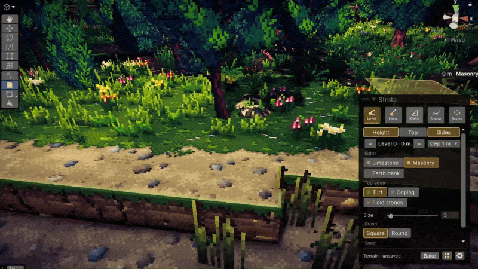

# Strata



[](https://github.com/carthageadev/strata/releases/latest/download/Strata.unitypackage)

A terrain painter for HD-2D maps in Unity.

Paint levels, ground, walls, edges and stairs in the Scene view, then bake to a plain prefab. The tool does not need terrain dependencies to run.

The painting tools run entirely in the Unity Editor.
Baked terrains use regular Unity meshes and materials.

## Setup

Unity 6 with URP. Copy this folder into `Assets/Strata` or clone this repo straight in your `Assets` folder

Or in the Package Manager, `+ > Install package from git URL` and paste:

```
https://github.com/carthageadev/strata.git
```

Strata checks for a new version once a session and asks before updating. Turn it off in `Preferences > Strata > Updates`.

## What it does

- paint levels and the walls build them self where two levels meet, no floating floors
- ground layers like grass, paving, sand, and pick the wall style per side
- stairs between two heights, a flight or a landing, stone or timber or your own step models
- curved stuff like hills, valleys and ramps
- **drag and drop**: grab textures or meshes and drop them on the strata window, it makes the materials for you. it reads albedo, normal, roughness etc from the file names, sets the import settings (normals, linear maps, point filter for pixel art) and packs an ORM map. walls and bricks go to sides, trims to edges, step models become stairs. works with files straight from explorer too
- tile sets and packs, share them as a .unitypackage
- bake gives a plain prefab, ur map dont need strata to run
- undo on every stroke, backups when u bake, crash recovery

## Use

- `Tools > Strata > New Terrain` to start
- `Tools > Strata > Terrain Editor` to paint
- `Tools > Strata > Materials` for tile sets

Open `Examples/Strata Sandbox` to try it.
