# Strata


[](https://github.com/carthageadev/strata/releases/latest/download/Strata.unitypackage)

A terrain painter for HD-2D maps in Unity.

Paint levels, ground, walls, edges and stairs in the Scene view, then bake to a plain prefab. The tool does not need terrain dependencies to run.

The painting tools run entirely in the Unity Editor.
Baked terrains use regular Unity meshes and materials.

## Setup

Unity 6 with URP. Copy this folder into `Assets/Strata` or clone this repo straight in your `Assets` folder

Or in the Package Manager, `+ > Install package from git URL` and paste:

```
https://github.com/carthageadev/strata.git
```

Strata checks for a new version once a session and asks before updating. Turn it off in `Preferences > Strata > Updates`.

## Start here

the simplest way to start: make a terrain, drag ur textures on the strata window and paint. thats it

1. `Tools > Strata > New Terrain`, pick a size and hit Create. it paints with the Default Set

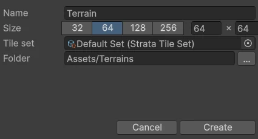

2. drag ur textures on the strata window, one or a whole folder, even straight from explorer. they become materials for u

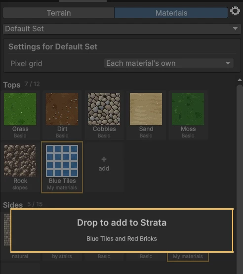

3. hit Edit and paint in the Scene view

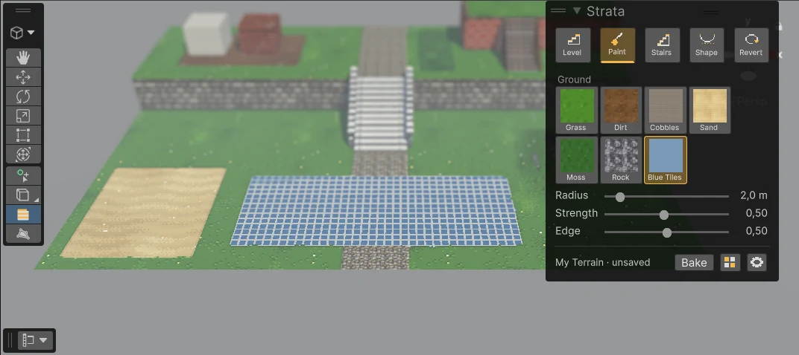

## Brushes

**Level** raises or lowers the ground. walls build them self where two levels meet, no floating floors

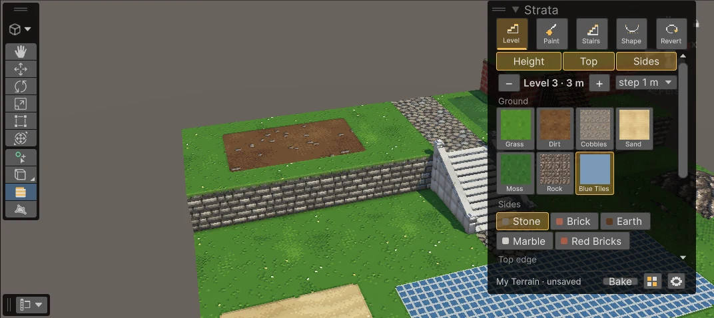

**Walls**: the Level brush with only Sides on restyles the walls and the edge on top, without touching the height

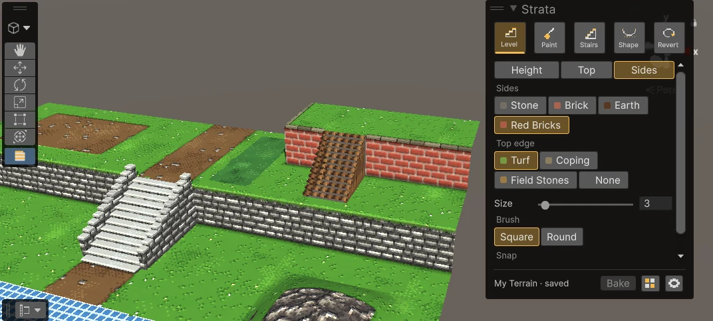

**Stairs** go between two heights, a flight or a landing. each type got its own look: stone with cheek walls, timber on posts for piers, dirt steps edged with timber, loose flat stones, brick between wing walls, or ur own step models

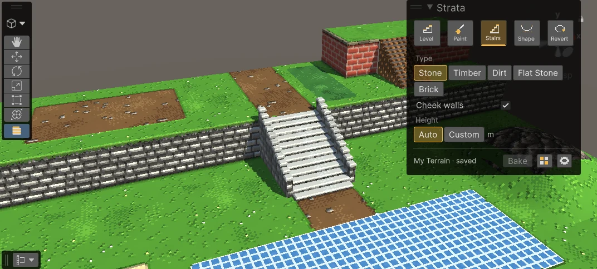

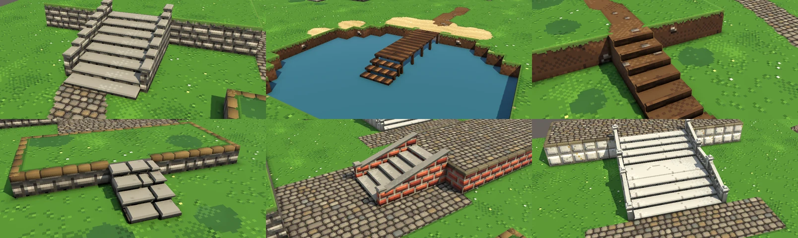

**Shape** makes hills, valleys, craters and ramps

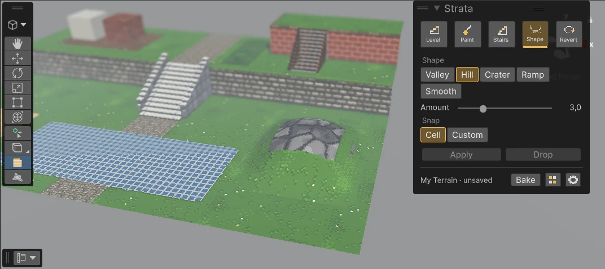

**Revert** paints a spot back to how the terrain was first made

## Materials

the Materials tab is where ur stuff lives. tops are the ground, sides are the walls, edges are the trim on top of the walls, and stairs. new ones blink so u see where they went

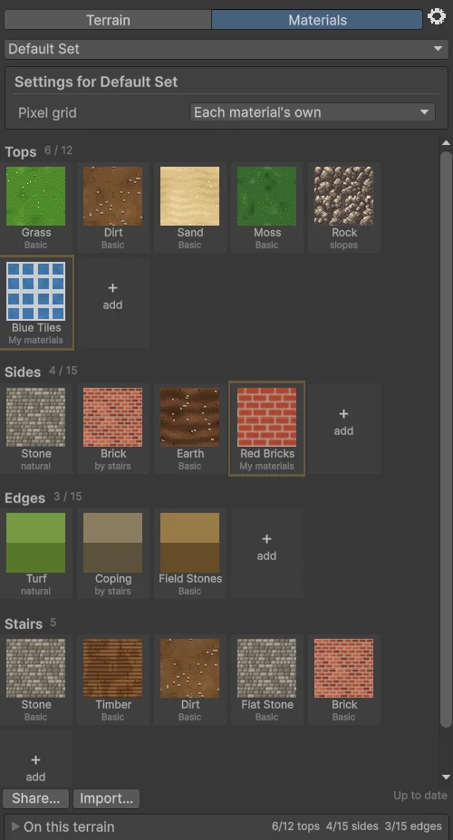

- the name decides the kind: wall, brick, cliff go to sides, edge, trim, coping go to edges, step models go to stairs, the rest are tops. drop on a section to pick the kind urself
- maps get matched by name (albedo, normal, roughness, ao...), normals get set up and small textures stay pixel sharp
- a stair type picks its steps (slabs, flagstones or timber edged dirt) and its sides (cheek walls, balustrade, wing walls or none)
- if u didnt pick a set it all goes in the Default Set
- share a material, a tile set or a pack as a .unitypackage

## Limits

one terrain can use 12 tops, 15 sides and 15 edges, stairs got no limit. its how the paint gets saved for now. the strata window shows what ur terrain uses, grey ones arent painted yet. it turns orange when ur almost full and red when ur full

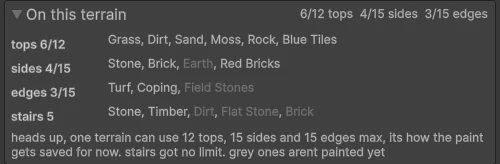

## Bake

Bake saves it all as a plain prefab, ur map dont need strata to run. undo works on every stroke, it backs up when u bake and it gets ur edits back if unity crashes

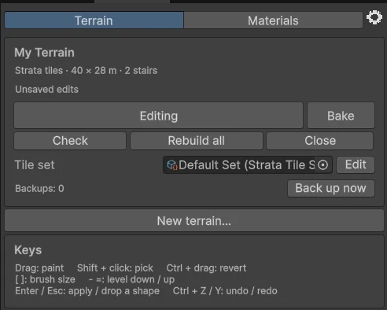

## Menus

- `Tools > Strata > New Terrain` to start
- `Tools > Strata > Terrain Editor` to paint
- `Tools > Strata > Materials` for tile sets

Open `Examples/Strata Sandbox` to try it, every stair type is in there.

## Credits

the rock is from the Dungeon Crawl Stone Soup tiles (CC0), thank u!
